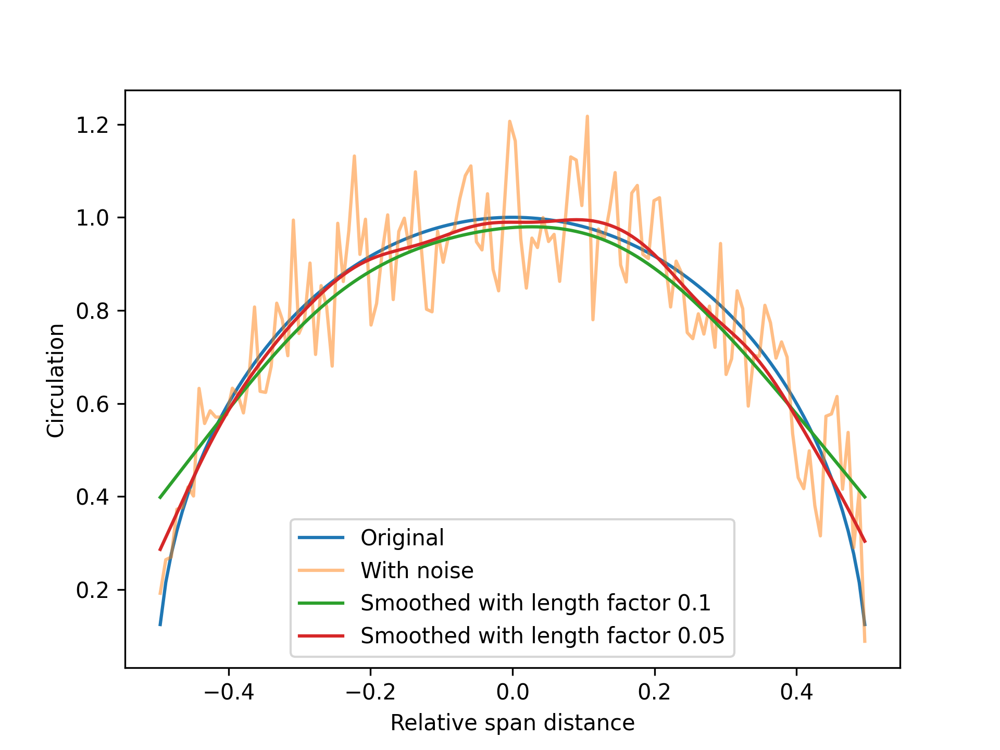

# Circulation strength

The circulation strength along a wing determines both the magnitude of the lift-forces and the induced velocities from the wing. The velocity is affected either through induced velocities from a wake model based on potential theory, in the case of lifting line simulations, or through body forces projected into a CFD domain, in the case of actuator line simulations.

This chapter specifies how the circulation strength is estimated from the local velocity on each line section, and how it is possible to modify the estimation for stability purposes. The procedure is the same for all simulation methods in Stormbird. That is, there are no differences in this regard between the static lifting line, dynamic lifting line or the actuator line. The responsibility for calculating the values are therefore given to the line force model.

## Raw lifting line theory estimation
The calculation of the circulation strength on each line element follows the [Kutta–Joukowski theorem](https://en.wikipedia.org/wiki/Kutta%E2%80%93Joukowski_theorem). The mathematical definition of the circulation value, \\( \Gamma \\), on a line element is as follows, where \\(U \\) is the velocity, and \\( L \\) is the lift per unit span.

\\[
    \Gamma = L / (U \rho)
\\]

The lift per unit span is further computed from the sectional lift coefficient, \\(C\_L\\) as follows, where \\(\rho\\) is the density and \\(c \\) the chord length:

\\[
    L = 0.5 \cdot \rho \cdot c \cdot C\_L \cdot U^2
\\]

When these equations are combined, we get the following equation for the circulation strength:

\\[
    \Gamma = 0.5 \cdot c \cdot C\_L \cdot U
\\]

The actual source code looks like the following (the negative values are to account for directional definitions)

```rust
pub fn circulation_strength_raw(
    &self, 
    angles_of_attack: &[f64],
    internal_states: &[f64],
    velocity: &[SpatialVector], 
) -> Vec<f64> {
    let mut cl = self.lift_coefficients_pre_stall_with_stall_drop_off(
        angles_of_attack, 
        internal_states,
        velocity
    );
    
    if self.force_calculation_settings.include_viscous_lift_in_the_circulation {
        let cl_viscous = self.lift_coefficients_post_stall_with_stall_weight(
            angles_of_attack,
            internal_states,
            velocity
        );
        
        for i in 0..cl.len() {
            cl[i] += cl_viscous[i];
        }
    }

    (0..velocity.len()).map(|index| {
        -0.5 * self.chord_lengths[index] * velocity[index].length() * cl[index]
    }).collect()
}
```

Note that, by default, only the pre-stall part of the lift coefficient from the sectional model is used to calculate the circulation strength. The post-stall part of the lift is instead treated as a separate *viscous lift* force, which does not affect the lift-induced velocities. This can be changed with the `include_viscous_lift_in_the_circulation` setting. See the [force calculations chapter](./force_calculations.md) for more.

For wings with a [dynamic stall model](../sectional_models/dynamic_stall.md), the split between the pre-stall and the post-stall lift is based on the dynamic amount of stall rather than the static value. This is the reason why the velocity is also given to the lift coefficient functions, as the dynamic stall model needs it to compute the non-dimensional time step.

## Optional corrections

Sometimes, there might be noise in the estimated circulation strength, which might cause instabilities and errors in the estimated forces. A typical example is lifting line simulations of stalled wings - especially when the lift coefficient is very large.

To handle such cases in a practical manner, there are optional *corrections methods* that can be used when estimating the circulation strength. These methods are controlled through a `CirculationCorrection` enum that is specified for the line force model. To set up different types of corrections, a `CirculationCorrectionBuilder` is used, which has the following structure:

```rust
pub enum CirculationCorrectionBuilder {
    None,
    Prescribed(PrescribedCirculation),
    Smoothing(CirculationSmoothingBuilder),
}
```

The default variant is `None`, which means that no corrections are applied. The effect of the other variants are explained below.

### Smoothing

The smoothing correction applies different types of smoothing filters to the estimated circulation, controlled through the following structure:

```rust
pub struct CirculationSmoothingBuilder {
    pub smoothing_type: SmoothingTypeBuilder,
    pub prescribed_to_subtract_before_smoothing: Option<PrescribedCirculation>,
}
```

The option to add a `prescribed_to_subtract_before_smoothing` is currently experimental. It subtracts a prescribed circulation distribution (see more about this below) from the estimated circulation before applying the smoothing filter. After the smoothing is applied, the prescribed distribution is added back to the smoothed result. The idea behind this is that it can avoid issues with smoothing the rapidly changing circulation at the wing tips. By subtracting a known distribution first, the smoothing filter only needs to handle the more noisy part of the circulation distribution. However, this feature is still experimental, and should be used with care.

The `smoothing_type` field specifies which type of smoothing filter should be applied. The available options are shown below:

```rust
pub enum SmoothingTypeBuilder {
    Gaussian(GaussianSmoothingBuilder),
    CubicPolynomial(CubicPolynomialSmoothingBuilder),
}
```

The first smoothing type is [Gaussian smoothing filter](https://en.wikipedia.org/wiki/Kernel_smoother). The available fields are shown below:

```rust
pub struct GaussianSmoothingBuilder {
    pub smoothing_length_factor: f64,
}
```

The `smoothing_length_factor` gives a factor used to calculate the smoothing length from the span of each wing in the line force model. That is, if the value is set to 0.01, the smoothing length will be 1% of the total span of each wing, independent of the value of the wing span or the number of sections.

Before the smoothing is applied, additional points are inserted beyond the tips of the wings. Which values that are inserted beyond the tips are dependent on whether the circulation is expected to be zero or not, controlled by the `non_zero_circulation_at_ends` field in the line force model. If the circulation is expected to be zero, the additional points are set to zero. If not, the additional points are set equal to the value at the end of the wing. The number of insertion points is calculated automatically based on the smoothing length and the number of sections.


An example of how this smoothing method affects the circulation distribution is illustrated in the figure below. **Note**: the example is with an excessive amount of noise, and is not representative of actual numerical noise from a lifting line simulation. Rather, it shows an example where an artificial elliptic circulation distribution was first generated, and then modified by adding random numerical noise. The plot then shows how the noise is reduced when the noisy circulation distribution is corrected using the Gaussian smoothing filter, with different values for the `smoothing_length_factor`.



As can be seen, simple Gaussian smoothing introduces some errors towards the end of the wings if the smoothing length is too large, although the random noise is effectively reduced. It is therefore generally recommended to only apply as little smoothing as necessary to stabilize a solution.

The second smoothing type is a cubic polynomial smoothing filter, which assumes that a cubic polynomial can be fitted to the points with a certain `window_size`. The larger the window size, the more smoothing is applied. The available fields are shown below:

```rust
pub enum WindowSize {
    Five,
    Seven,
    Nine
}

pub struct CubicPolynomialSmoothingBuilder {
    pub window_size: WindowSize,
}
```

## Prescribed distribution

Predetermined circulation distributions are a special mode where the circulation is forced to always follow a simple mathematical shape. For instance, it is possible to force the distribution to always be elliptical. This gives very stable simulations, and sometimes results that are very close to a *full simulation*. It is particularly useful if the goal is only to estimate interaction effects between wings, but where the lift and drag for a single wing is already known from, for instance, experimental or CFD results.

A view of the `PrescribedCirculation` structure:

```rust
pub struct PrescribedCirculationShape {
    pub inner_power: Float,
    pub outer_power: Float,
}

pub struct PrescribedCirculation {
    pub shape: PrescribedCirculationShape,
    pub curve_fit_shape_parameters: bool,
}
```

The option to `curve_fit_shape_parameters` is currently experimental. It will curve fit the shape parameters to the raw circulation distribution before applying the prescribed shape. However, it currently ends up with a relatively slow simulation, and the final results are not always better than just using default values for the shape parameters. It is set to false by default, and turning it on should be used with care and testing.

The `PrescribedCirculationShape` parameters in the structure are used to force the circulation to always follow a mathematical shape that looks like the equation below, where \\(s\\) is the local non-dimensional span distance, varying from -0.5 to 0.5 along each wing:

\\[
    \Gamma(s) = \Gamma\_0 (1.0 - (2 s)^{\text{inner\_power}})^{\text{outer\_power}}
\\]

The default values are to set `inner_power` to 2.0 and `outer_power` to 0.5. This corresponds to an elliptic distribution.
